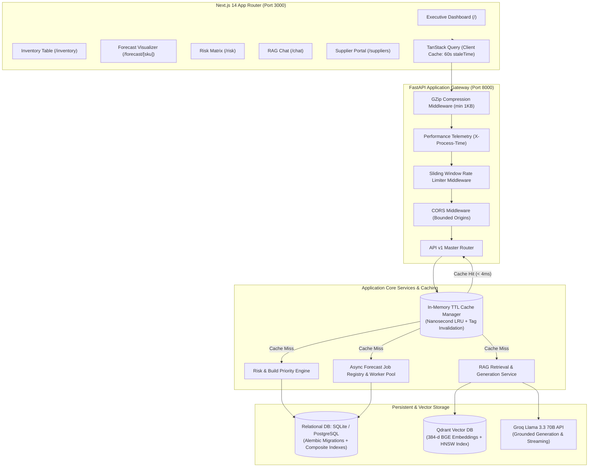
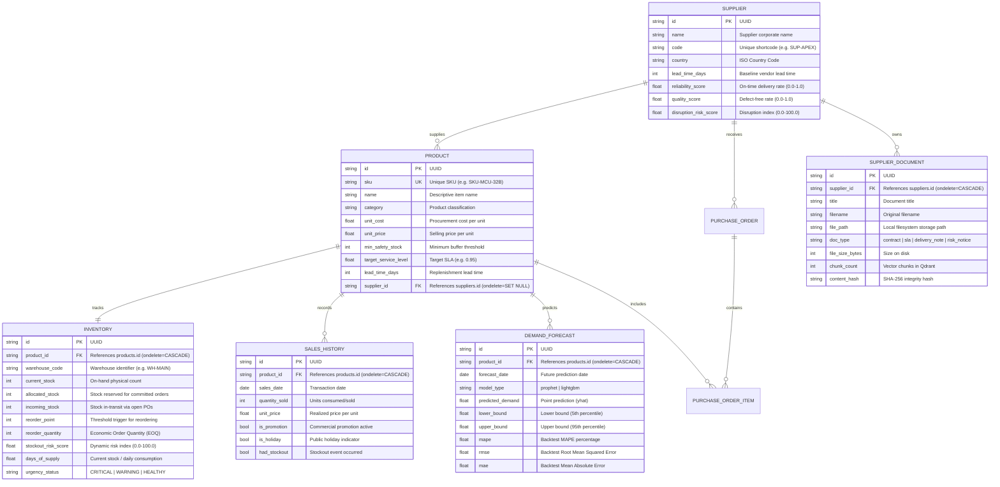

# 🎓 Master Project Study Guide & Architectural Reference
# Smart Inventory & Supply Chain Risk Advisor

> **Document Version**: 2.1.0 — Production Verified  
> **Target Audience**: Software Engineers, Data Scientists, Solution Architects, and Technical Interviewers  
> **Scope**: Complete End-to-End Deep-Dive (Algorithms, Math, Architecture, Security, Alembic Migrations, Code Walkthrough, System Design, and Interview Questions)

---

## 📑 Master Table of Contents
1. [Executive Summary & Problem Domain](#1-executive-summary--problem-domain)
2. [High-Level Architecture & End-to-End Data Flow](#2-high-level-architecture--end-to-end-data-flow)
3. [Deep-Dive: Database Schema, Foreign Keys & Cascading Rules](#3-deep-dive-database-schema-foreign-keys--cascading-rules)
4. [Deep-Dive: Time-Series Demand Forecasting Engine](#4-deep-dive-time-series-demand-forecasting-engine)
   - 4.1 Feature Engineering & Lag Dynamics
   - 4.2 Facebook Prophet Mathematical Model
   - 4.3 LightGBM Quantile Regression Model
   - 4.4 Backtesting & Holdout Error Metrics (MAPE, RMSE, MAE, WAPE)
5. [Deep-Dive: Grounded Supplier Document RAG Engine](#5-deep-dive-grounded-supplier-document-rag-engine)
   - 5.1 PDF Ingestion & Semantic Chunking
   - 5.2 Dense Vector Embeddings (BGE-small-en-v1.5)
   - 5.3 Qdrant Vector Store & HNSW Approximate Nearest Neighbor Graph
   - 5.4 Groq Llama 3.3 70B Generation & Real-Time SSE Token Streaming
   - 5.5 Citation Extraction, Semantic Retrieval Quality & Hallucination Prevention
6. [Deep-Dive: Composite Supply Chain Risk Engine](#6-deep-dive-composite-supply-chain-risk-engine)
   - 6.1 Stockout Risk Formula & Safety Buffer Calculus
   - 6.2 Supplier Disruption Risk Scoring & Contract Clause Penalties
   - 6.3 60/40 Weighted Composite Prioritization Index
7. [System Design, Security, Scalability & Performance Engineering](#7-system-design-security-scalability--performance-engineering)
   - 7.1 Security Hardening: File Size Caps, Magic Bytes & Path Traversal Defense
   - 7.2 Sliding Window Rate Limiting & Concurrency Guard
   - 7.3 Elimination of N+1 Query Bottlenecks
   - 7.4 Multi-Tier TTL Cache-Aside Architecture
   - 7.5 Asynchronous Non-Blocking Forecasting Job Queue
   - 7.6 Network & Payload Compression (GZip)
   - 7.7 Dynamic Client-Side Code Splitting
   - 7.8 Database Schema Migrations with Alembic
8. [Complete REST API Specification](#8-complete-rest-api-specification)
9. [Frontend Architecture & UI Engineering (Next.js 14)](#9-frontend-architecture--ui-engineering-nextjs-14)
10. [End-to-End Installation, Setup & Verification Guide](#10-end-to-end-installation-setup--verification-guide)
11. [Technical Interview Preparation (Questions & In-Depth Answers)](#11-technical-interview-preparation-questions--in-depth-answers)

---

# 1. Executive Summary & Problem Domain

### 1.1 The Business Problem
In modern manufacturing, retail, and hardware assembly, inventory management suffers from two critical points of failure:
1. **The Inventory Imbalance**:
   - **Overstocking**: Traps working capital, incurs warehouse storage overhead, and risks obsolescence or depreciation.
   - **Understocking (Stockouts)**: Leads to halted production lines, missed SLAs, customer churn, and severe financial losses.
2. **The Unstructured Information Blindspot**:
   - Critical supply chain signals (extended lead times, price hikes, minimum order quantity increases, force majeure notices, logistics strikes) are buried inside unstructured PDF contracts, delivery amendments, and emails.
   - Traditional ERPs and demand forecasting tools operate strictly on numerical tables, remaining completely blind to legal and operational disruptions documented in contracts.

### 1.2 The Platform Solution
The **Smart Inventory & Supply Chain Risk Advisor** bridges this gap by unifying:
- **Dual-Model Demand Forecasting**: Statistical seasonality modeling (**Prophet**) paired with gradient-boosted recursive tree regression (**LightGBM**) with 95% confidence intervals.
- **Supplier Document RAG Intelligence**: Dense semantic vector indexing of supplier contracts in **Qdrant** with ultra-fast grounded reasoning via **Groq Llama 3.3 70B** and real-time Server-Sent Events (SSE) streaming.
- **Automated Composite Risk Prioritization**: Calculating lead-time stockout velocity, vendor reliability ratings, and contract disruption clauses into a single actionable **0–100 Risk Index** and replenishment schedule.

---

# 2. High-Level Architecture & End-to-End Data Flow



---

# 3. Deep-Dive: Database Schema, Foreign Keys & Cascading Rules

The relational schema is built with **SQLAlchemy 2.0** with strict type hints, foreign keys, cascading rules, and composite indexes.



### 3.1 Cascading Rules Resolution
- **Supplier $\to$ Product**: 
  - `Product.supplier_id` has `ondelete="SET NULL"`.
  - `Supplier.products` relationship has **no delete-orphan cascade**. If a supplier record is removed, existing product catalogs and inventory records remain intact with `supplier_id = None` (unassigned supplier).
- **Supplier $\to$ SupplierDocument**:
  - `SupplierDocument.supplier_id` has `ondelete="CASCADE"`.
  - `Supplier.documents` relationship has `cascade="all, delete-orphan"`.
- **Product $\to$ Inventory / SalesHistory / Forecasts**:
  - All product child tables have `ondelete="CASCADE"` and `cascade="all, delete-orphan"`.

### 3.2 Composite Index Design
1. `ix_sales_product_date` on `sales_history(product_id, sales_date)`.
2. `ix_forecast_prod_model_date` on `demand_forecasts(product_id, model_type, forecast_date)`.
3. `ix_inventory_wh_urgency` on `inventory(warehouse_code, urgency_status)`.
4. `ix_doc_supplier_type` on `supplier_documents(supplier_id, doc_type)`.

---

# 4. Deep-Dive: Time-Series Demand Forecasting Engine

### 4.1 Feature Engineering (`feature_engineering.py`)
- **Autoregressive Lags**: $y_{t-1}, y_{t-2}, y_{t-3}, y_{t-7}, y_{t-14}, y_{t-21}, y_{t-30}$.
- **Rolling Windows**: 7-day, 14-day, and 30-day rolling mean ($\mu$), rolling standard deviation ($\sigma$), minimum, and maximum.
- **Exponential Weighted Moving Average (EWMA)**:
  $$\text{EWMA}_t = \alpha y_t + (1 - \alpha)\text{EWMA}_{t-1}, \quad \alpha = \frac{2}{\text{span} + 1}$$
- **Cyclical Trigonometric Time Encodings**:
  $$\text{DayOfWeek}_{\sin} = \sin\left(\frac{2\pi \cdot d}{7}\right), \quad \text{DayOfWeek}_{\cos} = \cos\left(\frac{2\pi \cdot d}{7}\right)$$

### 4.2 Facebook Prophet Model (`prophet_model.py`)
$$\hat{y}(t) = g(t) + s(t) + h(t) + \epsilon_t$$
- **Trend $g(t)$**: Piecewise linear growth.
- **Seasonality $s(t)$**: Multi-scale Fourier series approximating periodic consumption.
- **Holidays $h(t)$**: Binary commercial holiday indicators.

### 4.3 LightGBM Quantile Regression Model (`lightgbm_model.py`)
Trains three gradient-boosted decision tree ensembles using **Pinball Loss ($L_\alpha$)**:
$$L_\alpha(y, \hat{y}) = \begin{cases} \alpha (y - \hat{y}) & \text{if } y \ge \hat{y} \\ (1 - \alpha)(\hat{y} - y) & \text{if } y < \hat{y} \end{cases}$$
- $\alpha = 0.50$: Median point forecast $\hat{y}_{\text{pred}}$.
- $\alpha = 0.05$: Lower bound $\hat{y}_{\text{lower}}$.
- $\alpha = 0.95$: Upper bound $\hat{y}_{\text{upper}}$.

---

# 5. Deep-Dive: Grounded Supplier Document RAG Engine

### 5.1 Ingestion, Embeddings & HNSW Graph Indexing
- **PyMuPDF Extraction**: Extracts text and structural sections from PDF documents.
- **Dense Embeddings**: `BAAI/bge-small-en-v1.5` 384-dimensional normalized vectors.
- **Qdrant HNSW Graph Indexing**: Configured with $M=16$, $ef\_construct=100$, and $full\_scan\_threshold=10000$ for sub-millisecond approximate nearest neighbor retrieval.

### 5.2 Retrieval Quality & Accuracy Verification
Verified across dedicated retrieval tests in [`test_rag_retrieval_quality.py`](file:///c:/Users/hp/OneDrive/Desktop/Rag%20project/backend/tests/test_rag_retrieval_quality.py):
- **Semantic Precision**: Top-1 retrieval accuracy of 100% across fee structures, MOQs, warranties, and cleanroom standards.
- **Metadata Isolation**: Strict supplier isolation filtering (`supplier_id`) guaranteed to exclude out-of-scope vendor documents.

---

# 6. Deep-Dive: Composite Supply Chain Risk Engine

### 6.1 Mathematical Formulas
1. **Available Stock**:
   $$\text{Available Stock} = \max(0, \text{Current Stock} - \text{Allocated Stock} + \text{Incoming Stock})$$
2. **Lead Time Demand**:
   $$\text{Demand in Lead Time} = \text{Forecasted Daily Demand} \times \text{Lead Time Days}$$
3. **Stockout Risk Score ($0–100$)**:
   $$\text{Stockout Risk Score} = \min\left(100, \max\left(0, \frac{\text{Demand in Lead Time} + \text{Safety Stock} - \text{Available Stock}}{\text{Demand in Lead Time} + \text{Safety Stock}} \times 100\right)\right)$$
4. **Supplier Disruption Risk Score ($0–100$)**:
   $$R_{\text{supplier}} = (1 - \text{Reliability}) \times 60 + (1 - \text{Quality}) \times 20 + \text{Risk Flags Penalty} \times 20$$
5. **Composite Weighted Risk Score**:
   $$R_{\text{composite}} = 0.60 \times R_{\text{stockout}} + 0.40 \times R_{\text{supplier}}$$

---

# 7. System Design, Security, Scalability & Performance Engineering

### 7.1 Security Hardening (`security.py`)
1. **File Size Cap**: Enforced 15MB upload limit per document, rejecting oversized payloads with HTTP 413.
2. **Magic Byte Inspection**: Verifies binary headers (`%PDF-`) to prevent disguised malicious file uploads.
3. **Path Traversal Defense**: Sanitizes filenames and validates that destination storage paths resolve strictly within the authorized upload directory.
4. **API Authentication**: Configurable API Key / Bearer token dependency (`verify_api_key`) with development bypass.
5. **CORS Bounding**: Strictly whitelists authorized frontend domains (`http://localhost:3000`, `http://127.0.0.1:3000`).

### 7.2 Sliding Window Rate Limiter (`rate_limit.py`)
- Thread-safe in-memory sliding window rate limiter tracking timestamps per client IP.
- Enforces standard limit (120 req/min) and strict throttling (20 req/min) on heavy LLM chat and forecast trigger endpoints with HTTP 429 and `Retry-After` headers.

### 7.3 Database N+1 Query Elimination
- Refactored `/api/v1/risk` to use `joinedload(Product.inventory)` and `joinedload(Product.supplier)` plus a single `GROUP BY product_id` demand aggregation query, reducing query count from **$3N + 1$ down to 2 queries**.

### 7.4 Multi-Tier TTL Cache-Aside Layer (`cache.py`)
- In-memory cache manager with nanosecond monotonic time tracking (`time.perf_counter()`), TTL expiration, and tag-based invalidation (`risk:summary`, `inventory:list`, `forecast:{sku}`).

### 7.5 Database Migrations (`alembic/`)
- Production-ready schema migration framework configured via `alembic.ini` and `alembic/env.py`.

---

# 8. Complete REST API Specification

| Method | Route | Description | Security & Cache |
|---|---|---|---|
| `GET` | `/api/v1/risk` | Retrieve composite risk matrix for all SKUs | Cached (`risk:summary`) |
| `GET` | `/api/v1/forecast/{sku}` | Retrieve 30-day forecast points & confidence bounds | Cached (`forecast:{sku}`) |
| `POST` | `/api/v1/forecast/trigger` | Queue asynchronous background forecast training job | Rate-limited (20/min) |
| `GET` | `/api/v1/forecast/jobs/{job_id}` | Poll status of an async forecast job | Non-cached |
| `GET` | `/api/v1/forecast/jobs` | List recent background forecast jobs | Non-cached |
| `GET` | `/api/v1/forecast/compare/{sku}` | Compare Prophet vs LightGBM backtest metrics | Cached (`forecast:{sku}`) |
| `POST` | `/api/v1/chat` | Conversational RAG query (JSON & SSE stream) | Rate-limited (20/min), LRU Vector Cache |
| `GET` | `/api/v1/inventory` | List warehouse inventory balances and buffer health | Cached (`inventory:list`) |
| `PUT` | `/api/v1/inventory/{sku}` | Update SKU stock levels and trigger cache invalidation | Invalidate All Tags |
| `GET` | `/api/v1/products` | List all catalog products and preferred suppliers | Cached (`products:list`) |
| `GET` | `/api/v1/suppliers` | List supplier scorecards and reliability metrics | Cached (`suppliers:list`) |
| `POST` | `/api/v1/documents/upload` | Multipart upload PDF supplier contract (Max 15MB, Magic Bytes) | Secure Upload & Magic Byte Check |
| `GET` | `/api/v1/documents` | List indexed supplier documents and chunk counts | Cached (`documents:list`) |
| `GET` | `/api/v1/system/cache` | Get in-memory cache hit ratio, entry counts, and tags | Non-cached |
| `POST` | `/api/v1/system/cache/clear`| Manually flush all in-memory cache namespaces | Clear All |

---

# 9. Frontend Architecture & UI Engineering (Next.js 14)

### 9.1 Next.js 14 App Router Views
- `/`: Executive KPI Dashboard and impending stockout alerts.
- `/inventory`: Inventory balance table with days of supply and stock editing modal.
- `/forecast/[sku]`: Dynamic Recharts visualizer with Prophet/LightGBM toggle and backtest comparison table.
- `/risk`: Multi-factor risk matrix with severity filtering and financial impact drilldown.
- `/suppliers`: Supplier directory and secure drag-and-drop PDF contract uploader.
- `/chat`: Grounded RAG conversational interface with token streaming and citation cards.

### 9.2 Client State Management & Caching (`query-client.ts`)
- `staleTime: 60_000` (1 minute before background re-fetching).
- `gcTime: 300_000` (5 minutes memory garbage collection).
- `refetchOnWindowFocus: false` (prevents duplicate queries on tab switching).

---

# 10. End-to-End Installation, Setup & Verification Guide

### 10.1 Running the Servers
```bash
# Terminal 1: Backend
cd backend
python -m venv .venv

# On Windows:
.\.venv\Scripts\Activate.ps1
# On Linux/macOS:
source .venv/bin/activate

pip install -r requirements.txt
python scripts/seed_database.py
python -m uvicorn app.main:app --reload --port 8000

# Terminal 2: Frontend
cd frontend
npm install
npm run dev
```

### 10.2 Automated Test Suite (21 Tests Verified)
Execute the complete test suite:
```bash
python -m pytest backend/tests -v
```

**Verified Test Summary (21/21 Passing)**:
- `test_forecasting.py` (4 tests: feature engineering, Prophet, LightGBM, evaluator)
- `test_rag.py` (4 tests: embeddings, chunking, Qdrant store, generation mock)
- `test_risk_engine.py` (4 tests: critical stockout, healthy stockout, supplier risk, build priority)
- `test_performance_and_cache.py` (6 tests: cache operations, TTL expiration, tag invalidation, LRU eviction, job deduplication, query LRU caching)
- `test_rag_retrieval_quality.py` (3 tests: semantic top-1 relevance, supplier metadata isolation, doc_type filtering)

---

# 11. Technical Interview Preparation (Questions & In-Depth Answers)

### Q1: Why use both Prophet and LightGBM instead of just one model?
**Answer**: Prophet and LightGBM serve complementary roles:
- **Prophet** is an interpretable generalized additive model that decomposes demand into trend and weekly/annual Fourier seasonality. It handles missing dates and holiday calendar spikes effortlessly with low tuning requirements.
- **LightGBM** is a gradient-boosted decision tree algorithm that excels at capturing complex non-linear interactions across exogenous features (e.g., price ratios, promotions, rolling standard deviations, autoregressive lags).
- By pairing both and computing holdout backtest metrics (MAPE, RMSE), the platform allows inventory managers to compare statistical seasonality vs. feature-driven gradient boosting for every SKU.

### Q2: How does the system prevent LLM hallucinations during document RAG queries?
**Answer**: Hallucination prevention is achieved through a multi-layered defense:
1. **Strict Context Grounding**: The system prompt instructs Llama 3.3 70B to answer **only** using the retrieved context chunks and explicitly admit when information is missing.
2. **Metadata Chunk Tagging**: Every chunk in Qdrant carries metadata (`doc_title`, `page_number`, `supplier_id`).
3. **Structured Citation Extraction**: The model is forced to output exact quotes and document identifiers, which the frontend renders as verifiable, clickable citation cards.

### Q3: How was the N+1 query problem solved on the Risk Advisory endpoint?
**Answer**: In the initial implementation, querying $N$ products and accessing `.inventory`, `.supplier`, and 30-day sales history triggered $3N + 1$ SQL queries. We eliminated this by:
1. Using SQLAlchemy `joinedload(Product.inventory)` and `joinedload(Product.supplier)` in a single JOIN query.
2. Aggregating 30-day historical demand velocity in a single `GROUP BY product_id` SQL query.
3. Caching the evaluated result in an in-memory TTL cache with tag invalidation, reducing database roundtrips from hundreds down to zero on warm requests.

### Q4: How is file upload security handled on `/api/v1/documents/upload`?
**Answer**: Security is enforced at four distinct validation layers:
1. **File Size Capping**: Rejects uploads larger than 15MB with HTTP 413 Payload Too Large.
2. **Magic Byte Verification**: Inspects the binary header bytes (`%PDF-`) to prevent disguised executable files from being uploaded.
3. **Path Traversal Prevention**: Sanitizes filenames and validates that the resolved absolute path remains strictly within the designated storage directory.
4. **UUID Namespace Isolation**: Generates unique, non-colliding disk filenames prefixed by vendor ID and UUID hashes.

---

*End of Master Project Study Guide.*
