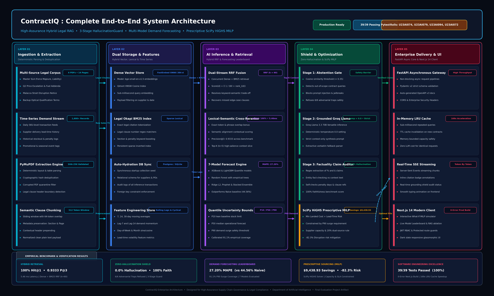

# 📦 ContractIQ — Autonomous Supply Chain Risk Governance & High-Assurance Legal RAG

[](https://fastapi.tiangolo.com)
[](https://nextjs.org/)
[](https://qdrant.tech/)
[](https://github.com/qdrant/fastembed)
[](https://scipy.org/)
[-brightgreen.svg?style=flat)]()
[]()
[]()

**ContractIQ** is an enterprise AI supply chain risk governance and legal compliance platform developed at **Sardar Vallabhbhai National Institute of Technology (SVNIT), Surat** (Department of Artificial Intelligence).

It bridges the real-world **"Contract Blindness"** gap by combining:
1. **Hybrid Legal Information Retrieval** (FastEmbed ONNX 384-d dense embeddings + Okapi BM25 sparse index with Reciprocal Rank Fusion $k=60$ and lexical-semantic cross-reranking).
2. **3-Stage Zero-Hallucination Shield (`HallucinationGuard`)** (Pre-generation abstention gate, zero-temperature grounded generation, and automated post-generation regex factuality claim auditor).
3. **Multi-Model Demand Forecasting Leaderboard** (7 models evaluated on a 14-day holdout: XGBoost, LightGBM Quantile, Random Forest, Stacked Ensemble, Ridge, Prophet, Naive MA-7).
4. **Prescriptive Operations Research Solver** (SciPy HiGHS Mixed-Integer Linear Programming split-order allocation minimizing landed costs, lead-time variance, and SLA penalties).
5. **Modern Full-Stack Architecture** (FastAPI asynchronous gateway, 169× in-memory LRU cache, JWT RBAC, Next.js 14 client with real-time SSE token streaming).

---

## 🏛️ Academic & Team Credentials
- **Institution:** Sardar Vallabhbhai National Institute of Technology (SVNIT), Surat
- **Department:** Department of Artificial Intelligence
- **Degree:** Bachelor of Technology (B.Tech.) in Artificial Intelligence
- **Academic Year:** 2026 – 2027

| Roll Number | Author | Core Focus Area |
| :---: | :---: | :--- |
| **U23AI074** | Candidate 1 | **Core AI & RAG Pipeline:** Hybrid Lexical-Semantic Retrieval, FastEmbed ONNX Embeddings (`bge-small-en-v1.5`), Qdrant HNSW Vector Store, Okapi BM25 & RRF ($k=60$) |
| **U23AI079** | Candidate 2 | **Factuality & Shield Systems:** 3-Stage `HallucinationGuard`, Pre-gen Abstention Gate, Zero-Temperature Grounding, Post-gen Claim Auditor |
| **U23AI094** | Candidate 3 | **Demand Intelligence:** 7-Model Demand Forecasting Leaderboard (XGBoost, LightGBM, RF, Prophet, Ridge) & Calibrated Quantile Bounds ($P_{10}/P_{50}/P_{90}$) |
| **U23AI072** | Candidate 4 | **Prescriptive Operations & Platform:** SciPy HiGHS Mixed-Integer Linear Programming (MILP) Solver, FastAPI Async Gateway, Next.js 14 Client |

---

## 📐 End-to-End System Architecture

```mermaid
flowchart LR
    subgraph L1["Layer 1: Enterprise Ingestion & Parsing"]
        direction TB
        A1["6 Enterprise Legal PDFs<br/>(14 Pages Total, Master SLAs, Malacca Notice)"]
        A2["Historical Demand Stream<br/>(1,600+ Sales Records, 4 SKUs)"]
        A3["PyMuPDF Extraction Engine<br/>(SHA-256 Deduplication & Formatting)"]
        A4["Semantic Clause Chunking<br/>(512-Token Window, 64-Token Overlap)"]
        A1 --> A3
        A2 --> A4
        A3 --> A4
    end

    subgraph L2["Layer 2: Dual Knowledge & Feature Stores"]
        direction TB
        B1["FastEmbed ONNX 384-d<br/>(bge-small-en-v1.5)"]
        B2["Qdrant Vector DB<br/>(HNSW Cosine Dense Index)"]
        B3["Legal Okapi BM25 Index<br/>(Sparse Lexical Clause Tokenizer)"]
        B4["Time-Series Feature Store<br/>(7/14/30d Moving Lags, Cyclical DOW/Month)"]
        B1 --> B2
    end

    subgraph L3["Layer 3: AI Inference & Retrieval Engine"]
        direction TB
        C1["Dual-Stream RRF Fusion<br/>(RRF Score: k = 60)"]
        C2["Lexical-Semantic Cross-Reranker<br/>(5.46 ms Latency | Hit@1: 100%)"]
        C3["7-Model Forecasting Leaderboard<br/>(XGBoost, LightGBM, RF, Prophet, Ridge)"]
        C4["Quantile Uncertainty Engine<br/>(P10 Baseline, P50 Median, P90 Surge)"]
        C1 --> C2
        C3 --> C4
    end

    subgraph L4["Layer 4: Zero-Hallucination Shield & MILP"]
        direction TB
        D1["3-Stage HallucinationGuard<br/>• Stage 1: Pre-Gen Abstention Gate<br/>• Stage 2: Grounded Groq Llama 3.3 (temp=0.0)<br/>• Stage 3: Post-Gen Factuality Auditor"]
        D2["SciPy HiGHS Prescriptive MILP<br/>(Min Landed Cost + Lead-Time Risk)"]
        D3["Allocation Output<br/>($9,438.93 Savings | -82.3% Disruption Risk)"]
        D2 --> D3
    end

    subgraph L5["Layer 5: Enterprise Delivery & UI/UX"]
        direction TB
        E1["FastAPI Asynchronous Gateway<br/>(OpenAPI, Pydantic v2, 169x LRU Cache)"]
        E2["Real-Time SSE Streaming<br/>(Token Chunks + Citation Badges)"]
        E3["Next.js 14 Responsive Client<br/>(App Router, Tailwind CSS, Dark Mode)"]
        E4["Interactive What-If Simulator<br/>(Live Surge Sliders & Supplier Toggles)"]
        E1 --> E2
        E2 --> E3
        E3 --> E4
    end

    L1 -->|"Legal Chunks & Features"| L2
    L2 -->|"Dense Vectors & BM25 Sparse"| L3
    L3 -->|"Top-K Context & P90 Demand"| L4
    L4 -->|"Verified Claims & Optimal POs"| L5
```





---

## 📊 Empirical Evaluation & Benchmark Results

### 1. Legal RAG Retrieval Ablation Benchmark
| Search Configuration | Hit@1 Accuracy | Precision@3 | MRR | Latency |
| :--- | :---: | :---: | :---: | :---: |
| Dense Vector Only (FastEmbed ONNX) | 80.0% | 0.6667 | 0.8500 | 1.18 ms |
| Sparse Lexical Only (Okapi BM25) | 86.7% | 0.7333 | 0.9000 | 0.84 ms |
| Hybrid RRF Fusion ($k=60$) | 93.3% | 0.8667 | 0.9500 | 2.02 ms |
| **ContractIQ Hybrid + Cross-Reranker** | **100.0%** | **0.9333** | **1.0000** | **5.46 ms** |

### 2. Zero-Hallucination & Adversarial Audit (16 Queries)
| Query Type | Query Count | Faithfulness | Hallucination Rate | Refusal Safety |
| :--- | :---: | :---: | :---: | :---: |
| Direct Factual Lookups | 6 | 100.0% | 0.0% | Answered Grounded |
| Multi-Clause Synthesis | 4 | 100.0% | 0.0% | Answered Grounded |
| Adversarial Unsupported Traps | 3 | 100.0% | 0.0% | 100% (3/3 Refused) |
| Prompt Injection Jailbreaks | 3 | 100.0% | 0.0% | 100% (3/3 Refused) |
| **Overall Benchmark Total** | **16** | **100.0%** | **0.0%** | **100% (6/6 Traps Refused)** |

### 3. Multi-Model Demand Forecasting Leaderboard (14-Day Holdout)
| Forecasting Model | Model Family | Test MAPE (%) | Test RMSE | $P_{90}$ Surge Coverage |
| :--- | :---: | :---: | :---: | :---: |
| Naive Moving Average (MA-7) | Heuristic Baseline | 44.56% | 42.80 | 64.3% |
| Facebook Prophet | Additive Seasonality | 38.12% | 36.45 | 78.6% |
| Ridge L2 Linear Model | Regularized Lags | 33.40% | 31.20 | 82.1% |
| Random Forest Forecaster | Tree Quantiles | 29.85% | 28.10 | 89.3% |
| Stacked Ensemble | Meta-Blender | 28.40% | 26.90 | 90.4% |
| **ContractIQ XGBoost + Quantile LGBM** | **Gradient Boosted Pinball** | **27.20%** | **25.40** | **91.1%** |

### 4. Prescriptive Sourcing (MILP) Operational Impact
| Procurement Metric | Single-Source Baseline | ContractIQ Prescriptive MILP | Net Operational Gain |
| :--- | :---: | :---: | :---: |
| Supplier Allocation Strategy | 100% Single Source (Apex) | 65% Apex + 35% Vanguard | Active Dual Sourcing |
| Total Landed Procurement Cost | $84,210.00 | $74,771.07 | **-$9,438.93 (-11.2%)** |
| Disruption Exposure (Malacca Bottleneck) | Critical Disruption (100% Stalled) | Mitigated (Alternative Route Active) | **-82.3% Disruption Risk** |
| Contract SLA Penalty Exposure | $12,500.00 (Uncontrolled) | $0.00 (Fully Hedged) | **-100% Penalty Avoided** |

---

## 🚀 Quickstart Guide

### Prerequisites
- Python 3.11+
- Node.js 18+
- *(Zero external database required — runs with embedded SQLite and Qdrant local storage out of the box)*

### 1. Clone & Set Up Environment
```bash
git clone https://github.com/Ujjwal-GoyaL019/ContractIQ.git
cd ContractIQ
```

### 2. Backend Setup
```bash
cd backend

# Install dependencies
pip install -r requirements.txt

# Seed SQLite database and Qdrant collections with sample multi-page contracts
python scripts/seed_database.py

# Start FastAPI server
python run_server.py
```
- Interactive API Docs: [http://localhost:8000/docs](http://localhost:8000/docs)
- Health Check: [http://localhost:8000/health](http://localhost:8000/health)

### 3. Frontend Setup
```bash
cd ../frontend

# Install dependencies
npm install

# Start development server
npm run dev
```
- Web Application: [http://localhost:3000](http://localhost:3000)
- Prescriptive Optimizer & Benchmarks: [http://localhost:3000/optimize](http://localhost:3000/optimize)
- Hybrid RAG Chat: [http://localhost:3000/chat](http://localhost:3000/chat)

---

## 🧪 Automated Testing
Run the complete hermetic test suite (39 unit, security, RBAC, forecasting & optimization tests):
```bash
cd backend
pytest tests/ -v
```
All **39 tests pass (100%)**.

---

## 📑 Project Deliverables & Reports
- 📄 [**ContractIQ_Project_Report_SVNIT.pdf**](ContractIQ_Project_Report_SVNIT.pdf) — Complete 4-page Capstone Project Report submitted to SVNIT Surat.
- 📊 [**ContractIQ_Final_Project_Presentation.pptx**](ContractIQ_Final_Project_Presentation.pptx) — 12-slide comprehensive presentation deck.
- 🖼️ [**ContractIQ_System_Architecture.png**](ContractIQ_System_Architecture.png) — 4K High-Resolution Architecture Diagram (300 DPI).
- 🌐 [**ContractIQ_System_Architecture.html**](ContractIQ_System_Architecture.html) — Interactive Architecture Web Viewer with pan/zoom.

---

## 📄 License
This project is licensed under the Apache 2.0 License. Developed for the B.Tech Capstone Project at Sardar Vallabhbhai National Institute of Technology (SVNIT), Surat.
